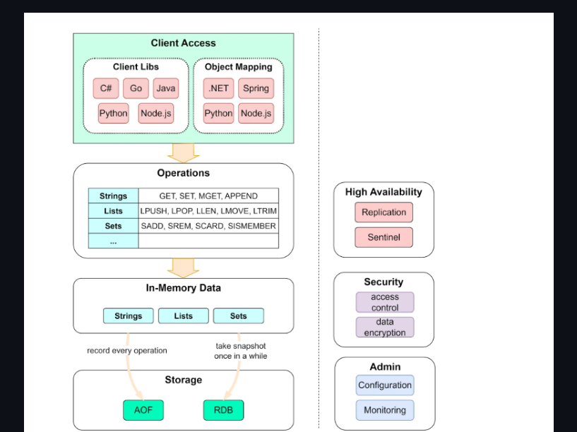
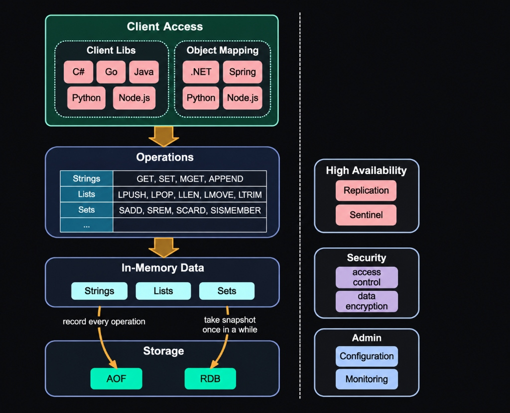
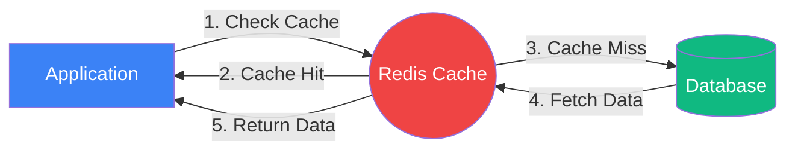
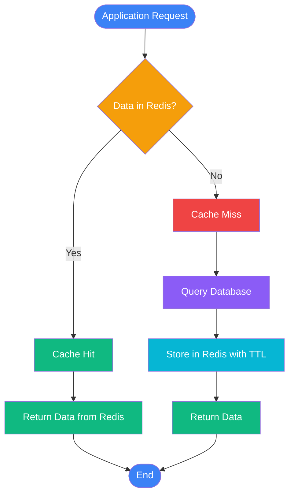

<div align="center">
  
</div>

# Redis - The Open Source, In-Memory Data Structure Store

Redis (Remote Dictionary Server) is an open-source, in-memory data structure store used as a database, cache, message broker, and streaming engine. It provides sub-millisecond response times, enabling millions of requests per second for real-time applications.

## Table of Contents

- [What is Redis?](#what-is-redis)
- [Key Features](#key-features)
- [Redis Advantages](#redis-advantages)
- [Data Types](#data-types)
- [Installation](#installation)
- [Python Client Setup](#python-client-setup)
- [Data Types & Operations](#data-types--operations)
- [Common Use Cases](#common-use-cases)
- [Best Practices](#best-practices)
- [Performance Tips](#performance-tips)
- [Redis CLI Commands](#redis-cli-commands)
- [Persistence Options](#persistence-options)
- [Resources](#resources)

---

## What is Redis?

Redis is a key-value store that supports various data structures including strings, hashes, lists, sets, sorted sets, bitmaps, hyperloglogs, and streams. Unlike traditional databases that store data on disk (such as MySQL, PostgreSQL, Oracle, MongoDB, Cassandra, and Microsoft SQL Server), Redis keeps data in memory, making it extremely fast.

<div align="center">
  
</div>

### Why Redis?

- **Speed**: Sub-millisecond latency, handles millions of operations per second
- **Flexibility**: Multiple data structures for different use cases
- **Simplicity**: Simple API, easy to learn and use
- **Versatility**: Can be used as database, cache, message broker, or streaming engine
- **Scalability**: Supports clustering for horizontal scaling

### What is Data Latency?

Data latency is the amount of time between data events, such as:
- The time between data generation and availability for a query
- The time between a query and delivery to the application

Latency is typically measured in milliseconds. However, real-time applications and analysis require as low latency as possible. Redis offers microsecond latency times, making it ideal for:
- Real-time analytics
- High-frequency trading
- Gaming leaderboards
- Session management
- Live dashboards

### What is Valkey?

[Valkey](https://valkey.io/) is an open source database that is a fork of Redis. It was formed after Redis Inc., which used to distribute Redis under an open source license, adopted a "source available" license for Redis in 2024. To maintain an open source alternative, several core Redis community members launched Valkey, starting with the last open source version of Redis.

Generally speaking, the technical information about Redis on this page is equally applicable to Valkey. Both databases share the same:
- Data structures and commands
- Performance characteristics
- API and client libraries
- Operational patterns

---

## Key Features

- In-memory data storage for high performance
- Support for multiple data structures
- Persistence options (RDB snapshots, AOF logs)
- Replication for high availability
- Clustering for horizontal scaling
- Transactions with MULTI/EXEC
- Pub/Sub messaging
- Lua scripting support
- Geospatial indexing
- Stream processing

### Redis Architecture Overview

<div align="center">
  
</div>

This diagram illustrates the complete Redis architecture including:
- **Client Access**: Multiple programming language support (C#, Go, Java, Python, Node.js)
- **Operations**: Commands for different data types (Strings, Lists, Sets)
- **In-Memory Data**: Fast data storage in RAM
- **Storage**: Persistence mechanisms (AOF for operation logging, RDB for snapshots)
- **High Availability**: Replication and Sentinel for failover
- **Security**: Access control and data encryption
- **Admin**: Configuration and monitoring tools

## Redis Advantages

Redis databases offer several key advantages:

- **Fast** - In-memory databases don't require disk access, reducing latency from milliseconds (ms) to microseconds (μs)

- **Flexible** - As a NoSQL database, Redis stores data without a fixed schema, giving you the flexibility to adapt your data structure as your application evolves

- **Scalable** - Redis supports sharding, which involves splitting and distributing data across multiple databases or machines, enabling horizontal scalability

- **Simple** - Redis enables developers to write potentially complex code in fewer lines, making it accessible for new users to learn and use

- **Highly Available** - Automatic failover is available, so applications remain operational even during failures

- **Open Source** - Older versions of Redis and all versions of Valkey are open source, meaning you can use those versions for your applications with no licensing cost and full flexibility in deployment. Newer versions of Redis are offered on a "source available" basis and may require a license

---

## Data Types

| Data Type | Description | Use Cases |
|-----------|-------------|-----------|
| **String** | Binary-safe text/data | Caching, counters, session storage |
| **Hash** | Key-value pairs | User profiles, object storage |
| **List** | Ordered collection | Queues, timelines, logs |
| **Set** | Unordered unique elements | Tags, unique visitors |
| **Sorted Set** | Sets with scores | Leaderboards, rankings |
| **Bitmap** | Bit-level operations | Flags, binary states |
| **HyperLogLog** | Cardinality estimation | Unique count approximation |
| **Stream** | Log-like structure | Event streams, messaging |

---

## Installation

### Using Docker (Recommended)

```bash
# Pull and run Redis
docker run -d -p 6379:6379 --name redis redis

# Run with persistence
docker run -d -p 6379:6379 -v redis_data:/data redis redis-server --appendonly yes

# Stop Redis
docker stop redis

# Start Redis
docker start redis
```

### Linux

```bash
# Ubuntu/Debian
sudo apt update
sudo apt install redis-server
sudo systemctl start redis
sudo systemctl enable redis

# CentOS/RHEL
sudo yum install redis
sudo systemctl start redis
sudo systemctl enable redis
```

### macOS

```bash
# Using Homebrew
brew install redis
brew services start redis
```

### Windows

Redis doesn't have native Windows support. Use:
- Docker (recommended)
- WSL (Windows Subsystem for Linux)
- Memurai (Windows-compatible Redis fork)

---

## Python Client Setup

### Installation

```bash
pip install redis
```

### Connection Methods

Redis supports multiple connection patterns:

1. **Basic Connection**: Simple direct connection to Redis server
2. **Connection with Authentication**: For password-protected Redis instances
3. **Connection Pool**: Reuses connections for better performance (recommended for production)

See `01_connection.py` for implementation examples.

---

## Data Types & Operations

### String Operations

Strings are the most basic Redis data type. They can store any kind of data - text, binary data, serialized objects, numbers.

Common string operations:
- `SET` - Store a value
- `GET` - Retrieve a value
- `SETNX` - Set only if key doesn't exist
- `SETEX` - Set with expiration time
- `INCR/DECR` - Increment/decrement numeric values
- `INCRBY/DECRBY` - Increment/decrement by specific amount
- `APPEND` - Append to existing string
- `GETRANGE` - Get substring
- `MGET` - Get multiple values at once

### Hash Operations

Hashes are maps between string fields and string values. They are perfect for representing objects.

Common hash operations:
- `HSET` - Set field value
- `HGET` - Get field value
- `HGETALL` - Get all fields and values
- `HMGET` - Get multiple field values
- `HINCRBY` - Increment field value
- `HEXISTS` - Check if field exists
- `HKEYS` - Get all field names
- `HVALS` - Get all field values
- `HLEN` - Get number of fields
- `HDEL` - Delete field

### List Operations

Lists are ordered collections of strings. They are implemented as linked lists, so adding elements to the head or tail is O(1).

Common list operations:
- `LPUSH/RPUSH` - Add to left/right end
- `LPOP/RPOP` - Remove from left/right end
- `LLEN` - Get list length
- `LRANGE` - Get range of elements
- `LINDEX` - Get element by index
- `LINSERT` - Insert before/after element
- `LREM` - Remove elements
- `LTRIM` - Trim list to range
- `BLPOP/BRPOP` - Blocking pop operations

### Set Operations

Sets are unordered collections of unique strings. They are useful for storing unique items and performing set operations.

Common set operations:
- `SADD` - Add member(s)
- `SREM` - Remove member(s)
- `SMEMBERS` - Get all members
- `SISMEMBER` - Check if member exists
- `SCARD` - Get set size
- `SPOP` - Remove and return random member
- `SRANDMEMBER` - Get random member without removing
- `SMOVE` - Move member to another set
- `SUNION` - Union of sets
- `SINTER` - Intersection of sets
- `SDIFF` - Difference of sets

### Sorted Set Operations

Sorted sets are sets where each member has an associated score. Members are ordered by score.

Common sorted set operations:
- `ZADD` - Add member with score
- `ZSCORE` - Get member's score
- `ZRANGE` - Get members by rank (low to high)
- `ZREVRANGE` - Get members by rank (high to low)
- `ZRANK` - Get member's rank (low to high)
- `ZREVRANK` - Get member's rank (high to low)
- `ZINCRBY` - Increment member's score
- `ZCOUNT` - Count members in score range
- `ZRANGEBYSCORE` - Get members by score range
- `ZREM` - Remove member
- `ZCARD` - Get number of members

See `02_data_types.py` for code examples of all data types.

---

## Common Use Cases

### 1. Caching

Redis is commonly used as a cache to reduce database load. The typical pattern is:
1. Check if data exists in Redis
2. If yes, return cached data (cache hit)
3. If no, fetch from database and store in Redis with expiration (cache miss)

#### Caching Architecture



**Explanation:**
- **Application**: Your web application or service
- **Redis Cache**: Fast in-memory cache layer
- **Database**: Traditional disk-based database (MySQL, PostgreSQL, etc.)

**Flow:**
1. Application requests data from Redis first
2. If data exists (Cache Hit): Redis returns it immediately (microseconds)
3. If data doesn't exist (Cache Miss): Application fetches from Database (milliseconds)
4. Database returns data to Application, which stores it in Redis for future requests
5. Data is returned to the user

This pattern significantly reduces database load and improves response times for frequently accessed data.

### 2. Session Storage

Store user session data in Redis for fast access and automatic expiration. Sessions can be stored with a TTL to automatically expire after inactivity.

### 3. Rate Limiting

Implement rate limiting to control how many requests a user can make in a time window. Redis's atomic increment operations make this easy to implement.

### 4. Leaderboard

Sorted sets are perfect for leaderboards. Players are members, scores are their points. Redis automatically keeps them sorted.

### 5. Simple Queue

Use Redis lists to implement a simple job queue. Producers push tasks, consumers pop and process them. Blocking operations allow consumers to wait for new tasks.

### 6. Unique Count with HyperLogLog

HyperLogLog provides approximate unique counts with minimal memory. Perfect for counting unique visitors, page views, etc.

### 7. Chat and Messaging

In-memory databases are ideal for high-traffic chat and messaging applications. Quick read and write speeds enable message updates in real time. Redis pub/sub and lists can be used to implement real-time messaging systems.

### 8. Streaming

In-memory storage is a great fit for real-time streaming applications that need to scale to high numbers of users. Redis streams provide a log data structure for storing and processing streaming data.

### 9. Real-time Analytics

Sub-millisecond response times enable fast analytics processing—ideal for use cases such as product recommendations, live dashboards, and real-time monitoring. Redis can aggregate and process data in real time without the latency of disk-based databases.

### 10. Geospatial Applications

With geospatial applications such as navigation, real-time information updates are critical. Redis supports geospatial indexing and queries, allowing you to store locations, calculate distances, and find points within a radius.

### 11. Personalization

Personalized user experiences rely on handling large amounts of data with sub-millisecond queries. Redis can power caching user information, session metadata, and personalized content recommendations.

See `03_use_cases.py` for implementation examples of these use cases.

---

## Best Practices

### Cache Implementation Pattern

When implementing caching with Redis, follow this decision flow:



**Explanation:**
This flowchart shows the complete caching implementation pattern:

1. **Application Request**: User or system requests data
2. **Check Redis**: First check if data exists in the cache
3. **Cache Hit (Yes)**: Data found in Redis - return immediately (fastest path)
4. **Cache Miss (No)**: Data not in Redis - proceed to database
5. **Query Database**: Fetch data from traditional database (slower)
6. **Store in Redis with TTL**: Save the data in cache with expiration time
7. **Return Data**: Send data back to the application

**Key Benefits:**
- **Cache Hit**: Microsecond response time (instant)
- **Cache Miss**: Millisecond response time (first time only)
- **TTL (Time To Live)**: Automatically expires old data to keep cache fresh
- **Subsequent requests**: Will hit the cache after the first miss

### 1. Use Connection Pooling

Create a connection pool and reuse connections instead of creating new ones for each operation. This reduces overhead and improves performance.

```python
from redis import ConnectionPool

pool = ConnectionPool(host="localhost", port=6379, db=0, max_connections=50)
r = redis.Redis(connection_pool=pool)
```

### 2. Set Appropriate TTL

Always set expiration (TTL) for temporary data like cache entries, sessions, and rate limit counters to prevent memory bloat.

```python
r.setex("cache_key", 3600, "value")  # 1 hour
r.set("cache_key", "value", ex=3600)  # Alternative syntax
```

### 3. Use Descriptive Key Names

Use consistent, descriptive key naming conventions. Examples:
- `user:123:profile` - User profile
- `product:456:details` - Product details
- `cache:article:789` - Cached article

### 4. Handle Connection Errors

Always handle connection errors gracefully. Redis might be temporarily unavailable, and your application should handle this gracefully.

```python
from redis.exceptions import ConnectionError, TimeoutError

try:
    r.set("key", "value")
except ConnectionError:
    print("Failed to connect to Redis")
except TimeoutError:
    print("Redis operation timed out")
```

### 5. Choose the Right Data Type

Select the appropriate data structure for your use case:
- Strings for simple key-value
- Hashes for objects with multiple fields
- Lists for queues/stacks
- Sets for unique collections
- Sorted sets for ranked data

### 6. Monitor Memory Usage

Monitor Redis memory usage and key counts. Use `MEMORY USAGE` command to check individual key sizes.

---

## Performance Tips

### 1. Use Pipelining for Bulk Operations

Use pipelining when executing multiple commands to reduce network round trips.

```python
pipe = r.pipeline()
pipe.set("key1", "value1")
pipe.set("key2", "value2")
pipe.execute()
```

### 2. Avoid Large Keys

Avoid storing very large values in single keys. Split data into multiple smaller keys if needed.

### 3. Use SCAN Instead of KEYS

The `KEYS *` command blocks the server. Use `SCAN` for non-blocking iteration over keys.

```python
# Bad - blocks server
all_keys = r.keys("*")

# Good - non-blocking
for key in r.scan_iter(match="user:*"):
    print(key)
```

### 4. Use Expire to Prevent Memory Bloat

Always set TTL on temporary data to prevent Redis from running out of memory.

### 5. Use Hashes for Related Data

Instead of multiple string keys, use a single hash to store related data together.

```python
# Instead of:
r.set("user:1:name", "John")
r.set("user:1:email", "john@example.com")

# Use:
r.hset("user:1", mapping={"name": "John", "email": "john@example.com"})
```

---

## Redis CLI Commands

Useful Redis CLI commands for testing and debugging:

```bash
# Connect to Redis
redis-cli

# Basic operations
SET key value
GET key
DEL key

# List all keys (use with caution in production)
KEYS *

# Get server information
INFO

# Monitor all commands (useful for debugging)
MONITOR

# Flush current database
FLUSHDB

# Flush all databases
FLUSHALL

# Check memory usage of a key
MEMORY USAGE key

# Get database size (number of keys)
DBSIZE

# Check TTL of a key
TTL key
```

---

## Persistence Options

### RDB (Redis Database)

RDB creates point-in-time snapshots of the dataset at specified intervals.

**Pros:**
- Compact files
- Fast backup and restore
- Good for disaster recovery

**Cons:**
- May lose data between snapshots
- Forking can be CPU-intensive

**Configuration in redis.conf:**
```
save 900 1     # Save after 900 sec if 1 key changed
save 300 10    # Save after 300 sec if 10 keys changed
save 60 10000  # Save after 60 sec if 10000 keys changed
```

### AOF (Append Only File)

AOF logs every write operation received by the server.

**Pros:**
- More durable
- Can survive crashes better
- Log can be easily parsed

**Cons:**
- Larger file size
- Slightly slower than RDB
- Can be rewritten to reduce size

**Configuration in redis.conf:**
```
appendonly yes
appendfsync everysec  # Sync every second (good balance)
```

### Hybrid Mode

Use both RDB and AOF for the best of both worlds - fast backups with good durability.

---

## Resources

### Official Documentation
- [Redis Official Website](https://redis.io/)
- [Redis Documentation](https://redis.io/docs/)
- [Redis Commands Reference](https://redis.io/commands/)

### Python Client
- [redis-py GitHub Repository](https://github.com/redis/redis-py)
- [redis-py Documentation](https://redis-py.readthedocs.io/)

### Learning Resources
- [Redis University](https://university.redis.com/) - Free interactive courses
- [Redis.io Try It](https://redis.io/try/) - Try Redis in browser
- [Redis Quick Start](https://redis.io/docs/getting-started/)

### Tools
- [RedisInsight](https://redis.com/redis-enterprise/redis-insight/) - Official GUI for Redis
- [Redis Commander](https://github.com/joeferner/redis-commander) - Web-based Redis manager
- [Another Redis Desktop Manager](https://github.com/qishibo/AnotherRedisDesktopManager) - Cross-platform GUI

---

## Code Examples

All Python code examples are organized in separate files for easy reference and execution:

| File | Description |
|------|-------------|
| `01_connection.py` | Connection setup examples (basic, authenticated, pooled) |
| `02_data_types.py` | All Redis data types operations (strings, hashes, lists, sets, sorted sets) |
| `03_use_cases.py` | Common use cases (caching, sessions, rate limiting, leaderboard, queue, HyperLogLog) |

---

## Prerequisites for Running Examples

Before running the Python examples, ensure you have:

1. Redis server running (locally or via Docker)
2. Python 3.6 or higher
3. redis-py library installed:
   ```bash
   pip install redis
   ```

Start Redis using Docker:
```bash
docker run -d -p 6379:6379 redis
```

---

## License

This documentation is provided for educational purposes. Redis is licensed under the BSD 3-Clause License.
